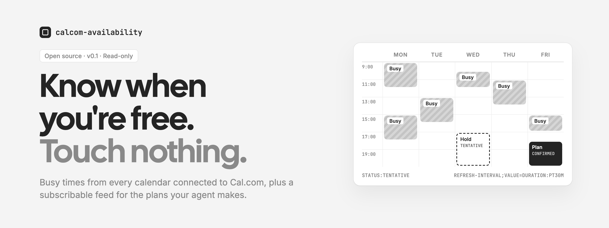
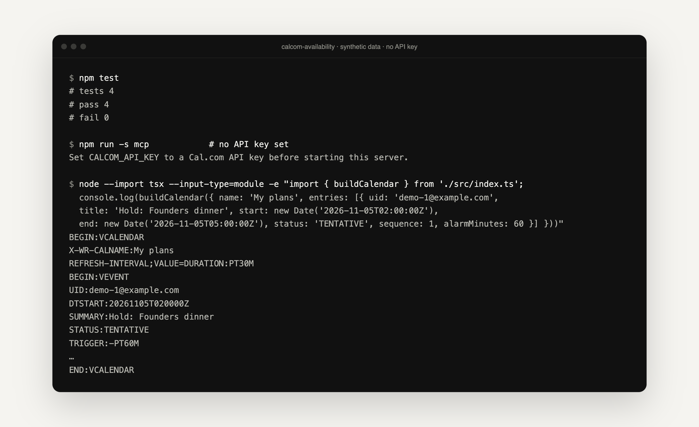
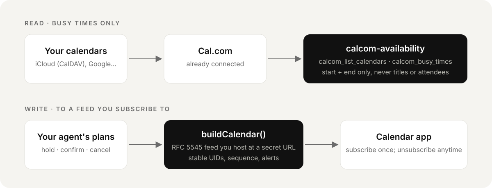

<p align="center">
  <picture>
    <source media="(prefers-color-scheme: dark)" srcset=".github/assets/banner-dark.png">
    
  </picture>
</p>

<p align="center">
  <strong>Calendar awareness for AI agents, without calendar write access.</strong><br>
  A tiny TypeScript library and MCP server: read busy times through Cal.com, and publish your agent's plans as a calendar feed you subscribe to.
</p>

<p align="center">
  <a href="#quick-start"><strong>Quick start</strong></a> ·
  <a href="#mcp-server"><strong>MCP server</strong></a> ·
  <a href="#how-it-works"><strong>How it works</strong></a> ·
  <a href="https://github.com/mihirkavi/open-media/tree/main/docs/events"><strong>Open Media Events</strong></a>
</p>

<p align="center">
  <a href="LICENSE"></a>
  
  <a href="https://github.com/mihirkavi/calcom-availability/actions/workflows/ci.yml"></a>
  
</p>

<p align="center">
  
  <br><sub>Real output with synthetic data and no API key. The iCalendar output is trimmed to its key lines.</sub>
</p>

## Why calcom-availability

An agent that plans things for you (dinners, meetups, trips) needs two things from your calendar: *when are you busy?* and *a place to put the plan*. The easy answer is full calendar access, which lets the agent read every title and attendee and edit anything.

**This package splits the job in two.** It reads only busy intervals through [Cal.com](https://cal.com), which already has your calendars connected (including iCloud over CalDAV). And it writes plans to a separate iCalendar feed that you subscribe to once and can drop at any time. Cal.com's own API books *your event types*; it does not create arbitrary holds on a connected calendar, and faking that with a booking would be wrong.

<table>
  <tr>
    <td width="33%" valign="top">
      <h3>Busy, not details</h3>
      Results contain start, end and an optional source label. Event titles and attendees are never returned.
    </td>
    <td width="33%" valign="top">
      <h3>Plans you can unsubscribe from</h3>
      <code>TENTATIVE</code> holds, <code>CONFIRMED</code> plans and <code>CANCELLED</code> retractions, in a standard RFC 5545 feed.
    </td>
    <td width="33%" valign="top">
      <h3>Small and plain</h3>
      Two library files with no runtime dependencies, plus an optional two-tool MCP server.
    </td>
  </tr>
</table>

## How it works

<p align="center">
  
</p>

The trade-off: subscribed calendars refresh on the calendar app's schedule (Apple Calendar lets you choose from every 5 minutes to weekly), so new holds are not instant. The feed suggests a 30-minute refresh with `REFRESH-INTERVAL` and `X-PUBLISHED-TTL`.

## Quick start

```bash
npm install github:mihirkavi/calcom-availability
```

```ts
import { buildCalendar, CalComAvailabilityClient, findConflicts } from 'calcom-availability';

// Read: busy intervals across the calendars connected to Cal.com
const cal = new CalComAvailabilityClient({ apiKey: process.env.CALCOM_API_KEY! });
const busy = await cal.busyTimes({ from, to, timeZone: 'America/Los_Angeles' });
const conflicts = findConflicts(busy, proposedStart, proposedEnd); // [{ start, end, overlapMinutes }]

// Write: a feed to publish at a secret URL and subscribe to once
const ics = buildCalendar({
  name: 'My plans',
  entries: [{ uid: 'plan-123@example.com', title: 'Hold: Founders dinner', start, end, status: 'TENTATIVE', url, sequence: 1 }],
});
```

Create the API key in **Cal.com → Settings → Developer → API Keys**. Keep it in a secret manager, never in source or prompts. Requires Node.js 22.13+.

<details>
<summary><strong>API reference</strong></summary>
<br>

| Export | What it does |
| --- | --- |
| `CalComAvailabilityClient({ apiKey, baseUrl?, fetch?, timeoutMs? })` | Read-only Cal.com v2 client. It never creates, changes or cancels anything. |
| `.listCalendars()` | Calendars connected to the account, and whether Cal.com checks each for conflicts (`GET /v2/calendars`). |
| `.busyTimes({ from, to, timeZone?, calendars? })` | Busy intervals in the window, using the calendars selected for conflict checking, or all connected calendars if none are selected (`GET /v2/calendars/busy-times`). |
| `findConflicts(busy, start, end)` | Busy intervals that overlap a proposed block, with overlap minutes. |
| `buildCalendar({ name, entries, refreshMinutes?, ... })` | RFC 5545 feed with stable UIDs, `SEQUENCE`, optional alerts, `OPAQUE`/`TRANSPARENT`, 75-octet line folding and text escaping. |
| `CalComError` | Clear errors for rejected keys, rate limits, timeouts and HTTP failures, without echoing the key. |

</details>

## MCP server

```bash
CALCOM_API_KEY=… npm run mcp
```

A stdio server named `calcom-availability` with two read-only tools:

| Tool | Returns |
| --- | --- |
| `calcom_list_calendars` | Connected calendars and whether each is checked for conflicts |
| `calcom_busy_times` | Busy intervals between `from` and `to`, plus conflicts with an optional `proposed_start`/`proposed_end` |

## Development

```bash
npm ci
npm run typecheck
npm test
```

Tests use mocked responses shaped like Cal.com's documented `/v2/calendars` and `/v2/calendars/busy-times` endpoints. CI runs the same steps on Node 22.

## Honest status

- **v0.1, not yet verified against a live Cal.com account.** The client is unit-tested against the documented response shapes only. When you connect yours, call `calcom_list_calendars` first.
- **Not on npm.** Install from GitHub as shown above.
- **Hosting the feed is up to you.** `buildCalendar` returns the iCalendar text; serving it at a secret URL is your app's job (Open Media Events does this).
- **Subscriptions are not instant.** Calendar apps refresh feeds on their own schedule.

## Part of Open Media Events

Built for [Open Media Events](https://github.com/mihirkavi/open-media/tree/main/docs/events), the event-planning service for AI assistants, but usable on its own.

## License

Released under the [MIT License](LICENSE).

<p align="center">
  <br>
  <sub><strong>calcom-availability</strong> · Know when you're free.</sub>
</p>
